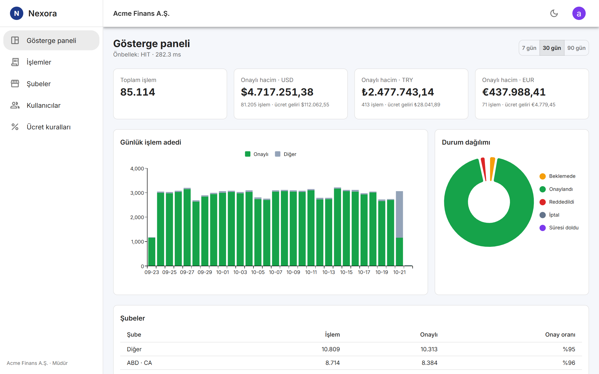
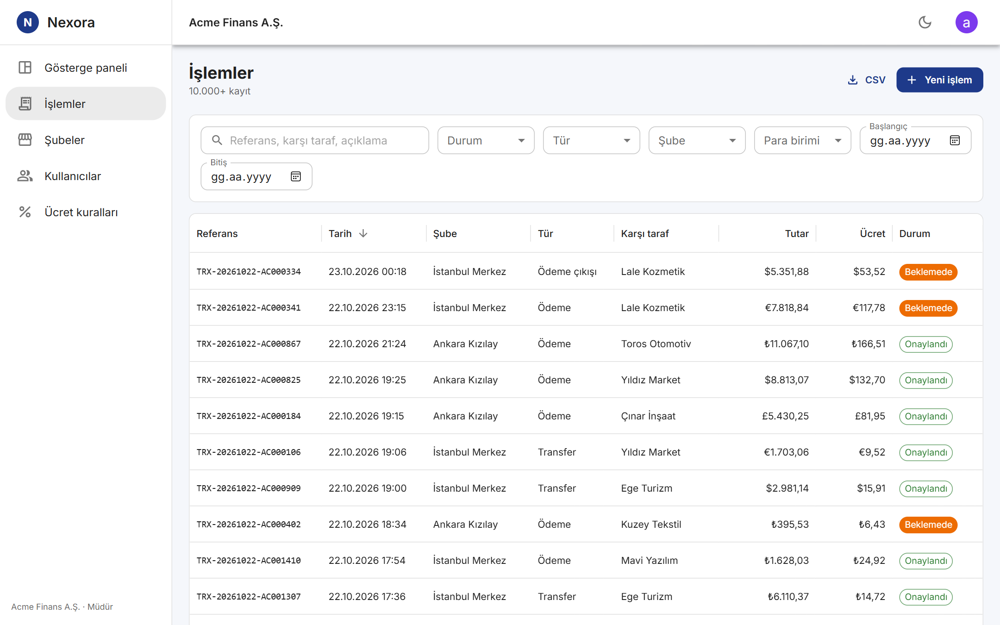
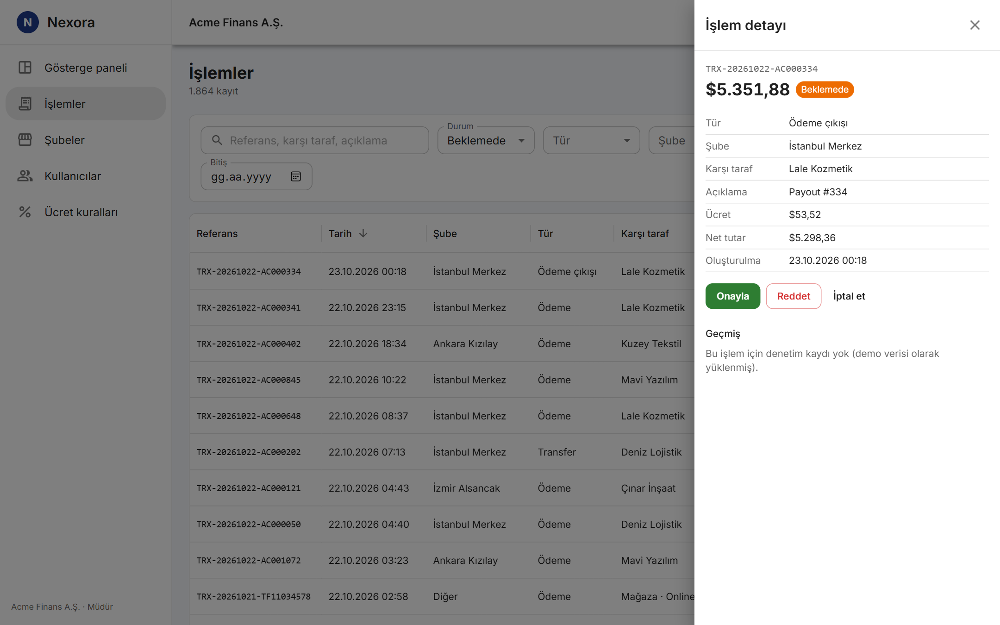
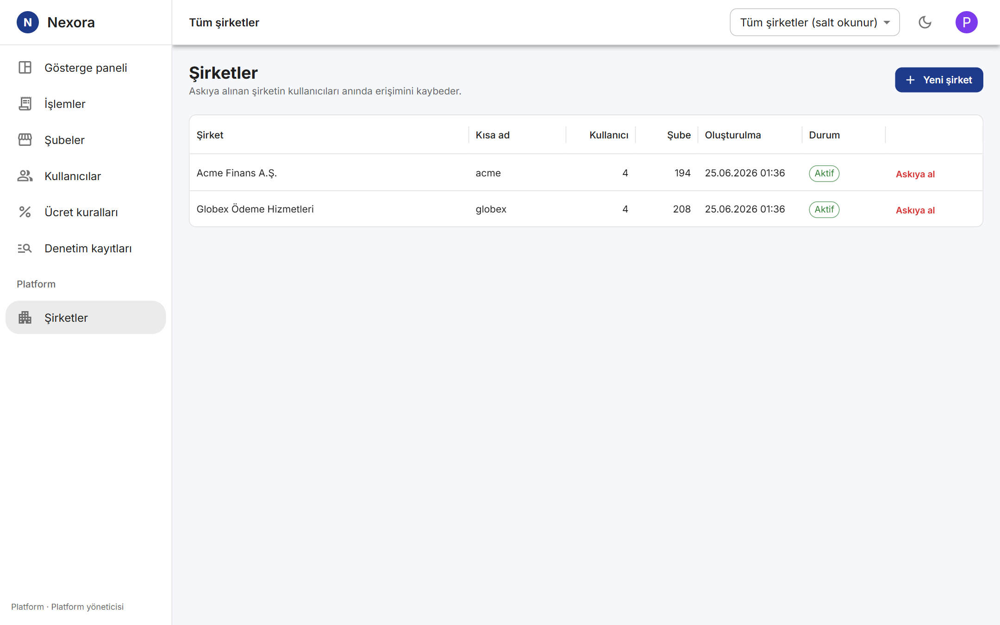
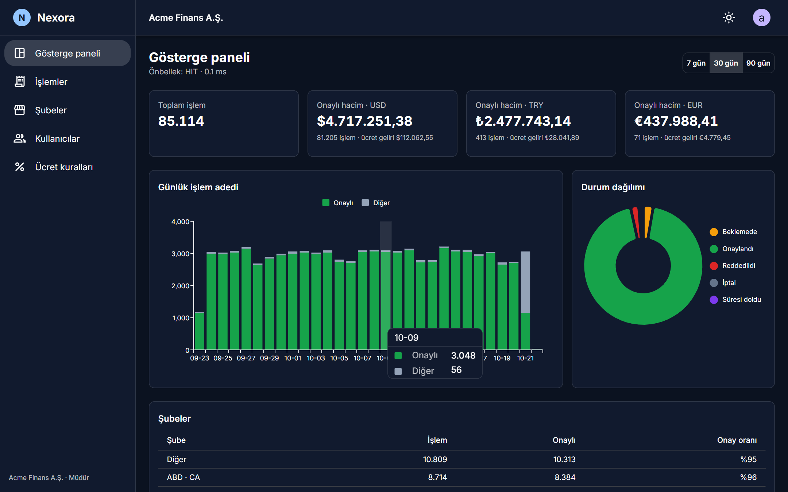

# Nexora — Multi-Tenant Operations Platform

[](https://github.com/physerkm/nexora/actions/workflows/ci.yml)
[](LICENSE)


**English** · [Türkçe](README.tr.md)

A multi-tenant SaaS for companies to run their branches, users, payments, fees and reports — built with
ASP.NET Core 10, EF Core, PostgreSQL 18 and React, and measured against **24 million real-shaped card transactions**.

- **Company A** sees only its own staff, branches and transactions. **Company B** only its own.
- The **platform admin** sees every company and acts on behalf of one only after selecting it.



## Highlights

- **Tenant isolation in three layers** — tenant from the signed JWT, EF Core global query filters that fail closed,
  and a `SaveChanges` guard against cross-tenant writes. Covered by integration and browser tests.
- **Revocable JWTs** — refresh-token rotation with reuse detection (the whole token family is revoked),
  `jti` denylist on logout, security-stamp check on every request.
- **Payments you can retry safely** — `Idempotency-Key` with atomic reservation (`INSERT … ON CONFLICT`),
  response replay and a unique-index safety net: 12 parallel requests with one key create exactly one row.
- **Explicit state machine** with the four-eyes rule (the creator cannot approve), optimistic concurrency on
  PostgreSQL `xmin`, and an **immutable audit log** enforced by a database trigger.
- **Built for large tables** — keyset pagination, trigram search, capped counts and index-backed sorting.
  Tuned by measurement on 24M rows (see below), not by guesswork.
- **Production basics** — structured logs with correlation IDs, health checks, rate limiting, transactional
  outbox with signed webhooks and exponential backoff, Docker Compose, GitHub Actions.
- **Tests at every level** — 172 backend tests (unit + integration on real PostgreSQL via Testcontainers),
  36 frontend component tests (Vitest, Testing Library, MSW) and 9 Playwright browser tests against the real stack.

## Measured on 24 million transactions

The [IBM TabFormer](https://github.com/IBM/TabFormer) synthetic card dataset (Apache-2.0) can be imported into the
demo companies with one script ([`tools/tabformer`](tools/tabformer)). Timings for a 12.1M-row company:

| Request | Before | After | What changed |
|---|---:|---:|---|
| Transaction list, page 1 | 2.0 s | 0.09 s | Count stops at 10,000 (`totalCountCapped`) |
| Sort by amount | 20 s | 0.1 s | `(tenant_id, amount, id)` index |
| Sort by status | 23 s | 0.1 s | `(tenant_id, status, created_at, id)` index |
| Search "market" (1.5M matches) | 23 s | 0.35 s | Capped count |
| Platform admin, all companies (24M) | 19 s | 0.08 s | `(created_at, id)` index + capped count |
| Dashboard, 90 days, cold cache | 2.8 s | 1.1 s | Report columns `INCLUDE`d → index-only scan |
| Dashboard, cached | 0.04 s | 0.04 s | HybridCache, invalidated by tag |

Indexes on the large table are added with `CREATE INDEX CONCURRENTLY` inside the EF Core migration, so writes keep flowing.

## Screenshots

| Transactions (12M rows → "10.000+") | Review with the four-eyes rule |
|---|---|
|  |  |
| **Platform admin** | **Dark mode** |
|  |  |

The user interface is in Turkish; the code, API and error codes are in English.

## Quick start

Requirements: .NET 10 SDK, Node.js 20.19+, PostgreSQL 18 (or Docker).

**With Docker Compose**

```bash
cp .env.example .env            # set JWT_SIGNING_KEY
docker compose up --build       # web: http://localhost:3000, API: http://localhost:8080/swagger
```

On a server, add `docker-compose.prod.yml` for automatic HTTPS (Caddy + Let's Encrypt); see [docs/deployment.md](docs/deployment.md#sunucuya-https-ile-kurulum) (Turkish).

**Without Docker**

```bash
# 1. Database user and database (development only, matches appsettings.Development.json)
psql -U postgres -c "CREATE ROLE nexora LOGIN PASSWORD 'nexora';" -c "CREATE DATABASE nexora OWNER nexora;"

# 2. API — applies migrations and seeds demo data in Development
dotnet run --project src/Nexora.Api --urls http://localhost:5080

# 3. Frontend (second terminal) — proxies /api to :5080
cd frontend && npm install && npm run dev      # http://localhost:5173
```

> On Windows with a Turkish system locale, choose **English, United States** on the PostgreSQL installer's
> Locale screen; the default `Turkish_Türkiye.1254` contains a non-ASCII character and initdb fails.

**Demo accounts** (password `Nexora#2026`)

| Email | Role |
|---|---|
| admin@nexora.io | Platform admin (all companies) |
| admin@acme.test | Company admin |
| manager@acme.test | Manager — approves and rejects |
| operator@acme.test | Operator — bound to one branch |
| auditor@acme.test | Auditor — read-only, audit log |
| admin@globex.test, manager@globex.test, … | Second company |

**Optional: 24M transactions** — `.\tools\tabformer\import-tabformer.ps1` downloads (266 MB), extracts (2.2 GB)
and loads the dataset (about an hour; ~25 GB free disk). The mapping is documented in the [Turkish README](README.tr.md#büyük-veri-ibm-tabformer-24-milyon-işlem-isteğe-bağlı).

## Architecture

```
src/
├── Nexora.Domain/          Entities, state machine, fee calculation — no infrastructure dependencies
├── Nexora.Application/     Use cases, DTOs, FluentValidation, request context, ports
├── Nexora.Infrastructure/  EF Core + PostgreSQL, JWT, HybridCache/Redis, outbox, background jobs
└── Nexora.Api/             Minimal API endpoint groups, auth policies, middleware, filters, rate limiting
tests/
├── Nexora.UnitTests/         Domain rules, validators, tokens, cursors, DbContext guards
└── Nexora.IntegrationTests/  Real API pipeline + real PostgreSQL (Testcontainers)
frontend/                   React 19, MUI 7 (DataGrid, Charts), Vite — component tests in src/, Playwright in e2e/
tools/tabformer/            24M-row import
docs/deployment.md          Migrations and deployment
```

Dependencies point inward: `Api → Infrastructure → Application → Domain`. `Program.cs` only composes; endpoints live in groups.

## How it works

<details>
<summary><b>Security and multi-tenancy</b></summary>

- **Tenant isolation**
  - The tenant comes from the signed `tenant_id` claim. A normal user sending `X-Tenant-Id` for another tenant gets
    `403 cross_tenant_access`; only platform admins may select a tenant.
  - EF Core global query filters on every tenant-owned table. Without a tenant (and without an explicit system scope)
    queries return nothing. Another tenant's record by ID returns `404`, so existence never leaks.
  - `SaveChanges` refuses to write a row that belongs to a different tenant than the request.
- **Passwords:** ASP.NET Core Identity, PBKDF2-HMAC-SHA512 with 210,000 iterations, lockout after 5 failures. Unknown
  emails still compute a hash, so response time does not reveal which accounts exist.
- **Tokens**
  - Access token: 15-minute JWT, kept in memory only (never in `localStorage`).
  - Refresh token: 512-bit random value, stored as a SHA-256 hash, sent as an `HttpOnly; Secure; SameSite=Strict`
    cookie scoped to `/api/v1/auth`. Single use; reuse revokes the whole family and is audited.
  - Revocation: `jti` denylist on logout; security stamp renewed on logout-all, password change, deactivation and
    role change; suspending a company cuts off its users immediately.
- **Authorization:** named policies (`transactions:review`, `reports:view`, …) instead of role checks in endpoints,
  a fallback policy requiring an authenticated user of an active tenant, and a resource-based branch requirement.
</details>

<details>
<summary><b>Data and performance</b></summary>

- `GET /api/v1/transactions`: filters, index-backed sorting, offset or keyset (`paging=cursor`) pagination, and
  `ILIKE` search backed by `pg_trgm` GIN indexes (user wildcards are escaped).
- Keyset pagination uses the row-value comparison `(created_at, id) < (@c, @i)`, which maps straight onto
  `(tenant_id, created_at DESC, id DESC)`. CSV export streams with the same method.
- Counts are capped at 10,000 (`SELECT count(*) FROM (… LIMIT 10001)`); the UI shows "10.000+".
- The default listing index `INCLUDE`s status, branch, currency, amount and fee, so dashboard aggregates are
  index-only range scans.
- Optimistic concurrency on PostgreSQL's `xmin`: a stale `version` returns `409 concurrency_conflict`.
- Business change, audit record and outbox event are written in one `SaveChanges`.
</details>

<details>
<summary><b>Business rules</b></summary>

```
Pending ──approve──▶ Approved ──cancel (reviewer only)──▶ Cancelled
   ├──reject──▶ Rejected
   ├──cancel──▶ Cancelled
   └──expire (background job)──▶ Expired
```

- The API returns `allowedTransitions` with every transaction; invalid transitions return `409 invalid_state_transition`.
- Four-eyes rule: the creator cannot approve or reject (`422 four_eyes_violation`).
- Fees: `amount × rate + fixed`, clamped to min/max and never above the amount; currency-specific rules win.
- Idempotency: atomic reservation, replay with `Idempotent-Replayed: true`, `422` for the same key with a different
  body, `409` while the first request is still running, key released after a business error.
- Audit log: no mutating methods, a `SaveChanges` guard, and a trigger that rejects `UPDATE`, `DELETE` and `TRUNCATE`.
- Errors: RFC 9457 `application/problem+json` with a stable `code`, `traceId` and `correlationId`.
</details>

<details>
<summary><b>Production readiness</b></summary>

- Serilog (JSON in production) with `CorrelationId`, `TenantId` and `UserId` on every line.
- `/health/live` and `/health/ready` (database and cache).
- Rate limiting: token bucket per user, fixed window per IP, 10/min per IP for login and refresh.
- HybridCache with optional Redis L2. The report endpoint returns `X-Cache` and `Server-Timing`, so the benefit is
  measured: cold ~185 ms vs cached ~0.3 ms on the demo data. Cache lookups run in their own DI scope, so an aborted
  request can never dispose a lookup that other requests share.
- Transactional outbox processed with `FOR UPDATE SKIP LOCKED`; webhooks signed with HMAC-SHA256; HTTP resilience
  plus per-message exponential backoff with jitter.
- Maintenance worker (expiry, cleanup) guarded by a PostgreSQL advisory lock.
- Multi-stage Docker images, non-root API, nginx serving the SPA and proxying `/api` same-origin.
</details>

## Tests

```bash
dotnet test                         # unit + integration (Docker for Testcontainers, or NEXORA_TEST_POSTGRES)
cd frontend && npm test             # component tests
cd frontend && npm run test:e2e     # browser tests: starts the API and Vite against a fresh nexora_e2e database
```

| Suite | Count | What it covers |
|---|---:|---|
| Unit | 89 | Domain rules, fee calculation, validators, tokens, cursors, DbContext guards |
| Integration | 83 | Tenant isolation, 401/403 matrix, token rotation and revocation, idempotency under concurrency, audit trigger, outbox, caching |
| Frontend components | 36 | Token refresh (one shared refresh for concurrent 401s), role-based UI, four-eyes UI, idempotency key reused on retry, capped count, theme |
| Browser (Playwright) | 9 | Sign-in/reload/sign-out, tokens unreadable from scripts, create → approve and reject flows, tenant isolation, platform admin scope |

CI runs all of them on every push, plus a migrations-in-sync check, an idempotent migration script and Docker image builds.
See [docs/deployment.md](docs/deployment.md) for migrations and deployment (in Turkish).

## Contributing

Issues and pull requests are welcome — see [CONTRIBUTING.md](CONTRIBUTING.md).

## License

[MIT](LICENSE)
